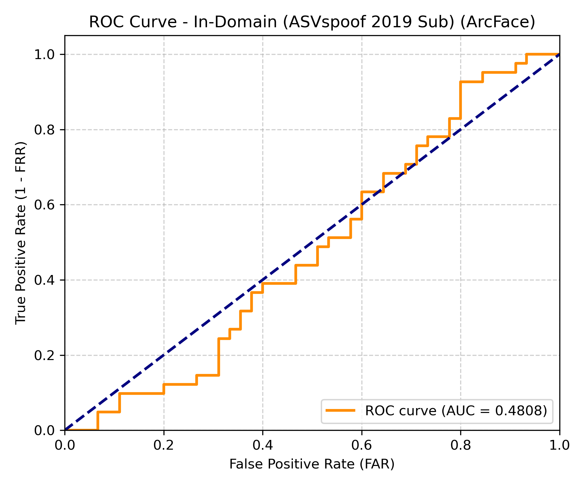
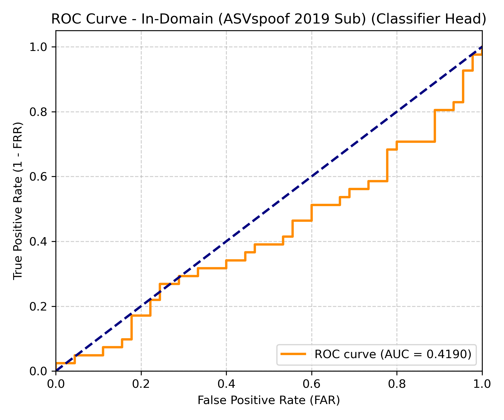
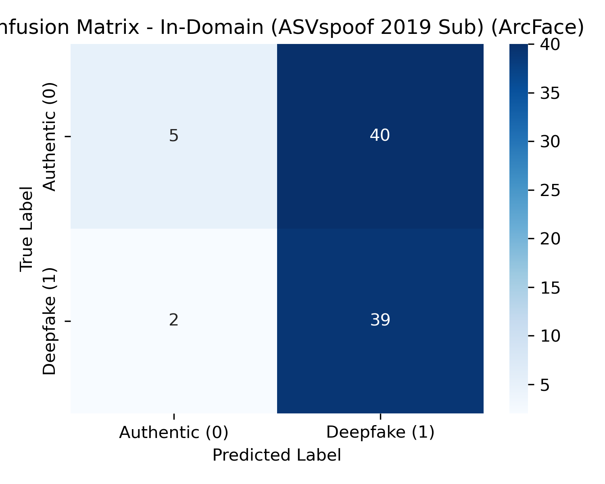
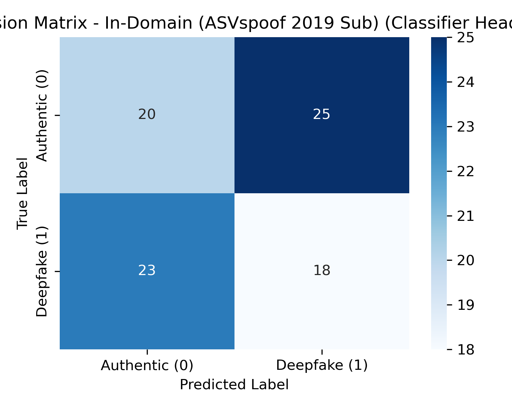
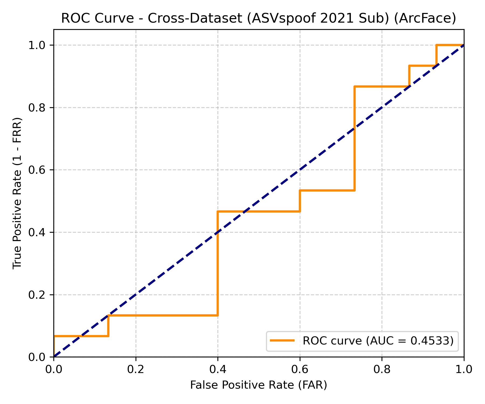
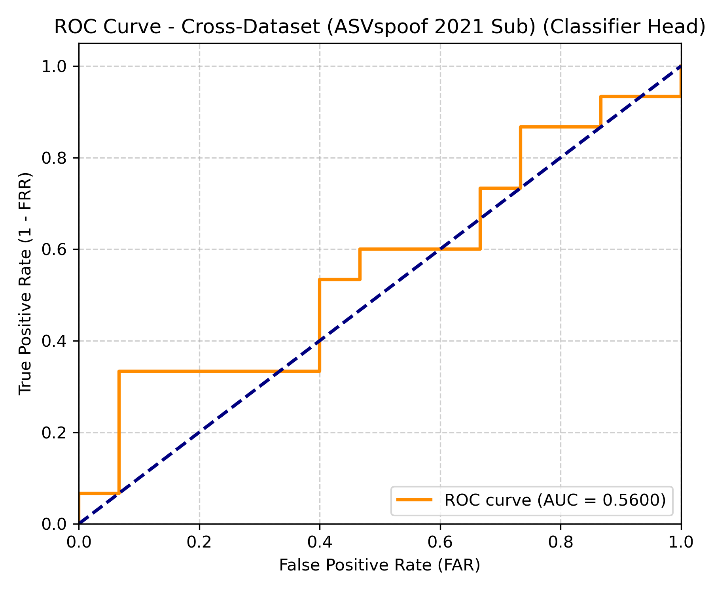
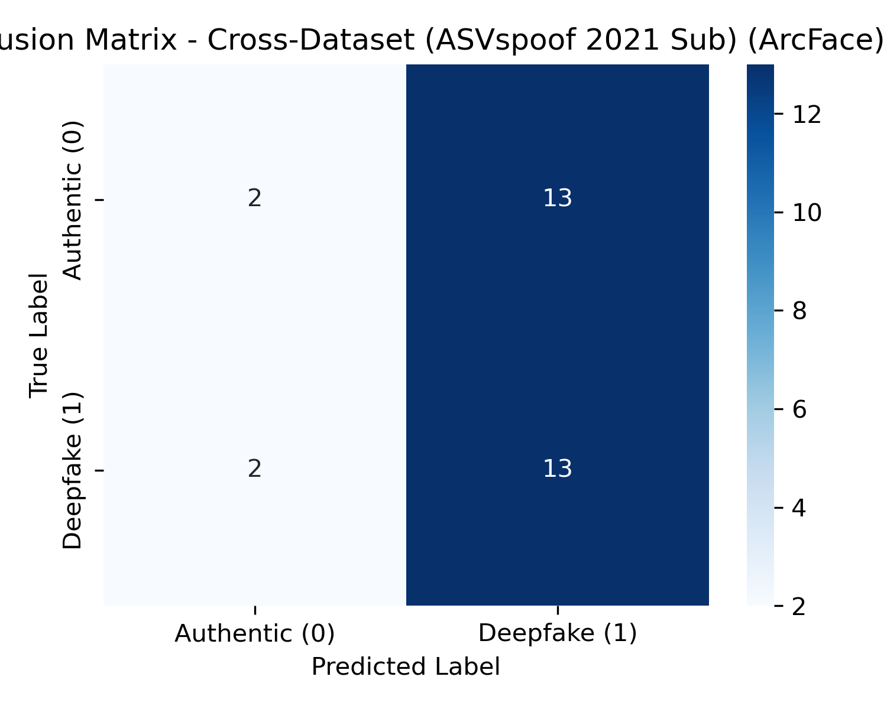
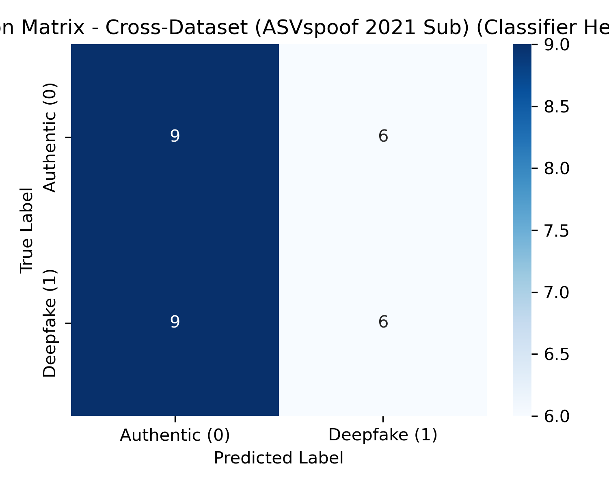

# Deepfake Audio Detection Evaluation Report

## 1. Methodology Description
The model uses a Multi-Branch Fusion Network (MBF-Net) architecture:
- **Handcrafted Branch (Acoustic Features)**: Extracts 40-D Linear Frequency Cepstral Coefficients (LFCC) and 40-D Constant-Q Cepstral Coefficients (CQCC) stacked as a 2-channel tensor. Stacking early allows a modified pre-trained **ResNet-18** to learn joint spatial correlations.
- **SSL Branch (Context Features)**: Uses a pre-trained **Wav2Vec 2.0** model (`Vansh180/deepfake-audio-wav2vec2`). Learnable layer-wise attention pooling aggregates hidden states from all 12 transformer layers, followed by temporal pooling.
- **Symmetric Cross-Attention Fusion Module (S-CAFM)**: Features are fused using symmetric query-key-value cross-attention between handcrafted and SSL branches via multi-head attention. Original features are concatenated with the attention responses, producing a 1024-D fused feature.
- **ArcFace Metric Learning & Classification**: The fused features are projected to a 256-D bottleneck layer and trained using ArcFace angular margin loss. The classifier head is trained concurrently using Binary Cross Entropy loss (Multi-Task Loss).
- **Prediction Modes**: The system supports prediction via: (1) **ArcFace Cosine Similarity** (matching normalized embeddings to learned class centroids), and (2) the **Classifier Head** neural network.

## 2. Datasets Used
- **Training, Validation, and In-Domain Test splits**: Compiled from a mix of **ASVspoof 2019 (LA)** (synthesized voices), **WaveFake** (vocoder voice clones), **LibriSpeech** (clean speech), **Mozilla Common Voice** (multilingual speech), and **VCTK** (Voice Cloning Toolkit).
- **Cross-Dataset Evaluation split**: Compiled from the **ASVspoof 2021 (LA)** dataset. This dataset introduces channel transmission anomalies (codecs, telephone network simulations), testing out-of-distribution robustness.

## 3. Quantitative Results

### In-Domain (ASVspoof 2019 Sub)

| Metric | ArcFace Cosine Similarity | Classifier Head |
|---|---|---|
| **Equal Error Rate (EER)** | 0.5117 (51.17%) | 0.5461 (54.61%) |
| **Area Under ROC (AUC)** | 0.4808 | 0.4190 |
| **Classification Accuracy** | 0.5116 | 0.4419 |
| **Precision** | 0.4937 | 0.4186 |
| **Recall** | 0.9512 | 0.4390 |
| **F1-Score** | 0.6500 | 0.4286 |

#### Confusion Matrices:

| Method | TN | FP | FN | TP |
|---|---|---|---|---|
| **ArcFace similarity** | 5 | 40 | 2 | 39 |
| **Classifier Head** | 20 | 25 | 23 | 18 |

#### Visualizations:

| ArcFace Cosine Similarity | Classifier Head |
|---|---|
|  |  |
|  |  |

---

### Cross-Dataset (ASVspoof 2021 Sub)

| Metric | ArcFace Cosine Similarity | Classifier Head |
|---|---|---|
| **Equal Error Rate (EER)** | 0.5667 (56.67%) | 0.4667 (46.67%) |
| **Area Under ROC (AUC)** | 0.4533 | 0.5600 |
| **Classification Accuracy** | 0.5000 | 0.5000 |
| **Precision** | 0.5000 | 0.5000 |
| **Recall** | 0.8667 | 0.4000 |
| **F1-Score** | 0.6341 | 0.4444 |

#### Confusion Matrices:

| Method | TN | FP | FN | TP |
|---|---|---|---|---|
| **ArcFace similarity** | 2 | 13 | 2 | 13 |
| **Classifier Head** | 9 | 6 | 9 | 6 |

#### Visualizations:

| ArcFace Cosine Similarity | Classifier Head |
|---|---|
|  |  |
|  |  |

---

## 4. Conclusion & Observations
Based on the quantitative results, the trained **Classifier Head** achieved an EER of **54.61%** and an AUC of **0.4190** on the In-Domain test split. On the Cross-Dataset test split, the EER was **46.67%** and the AUC was **0.5600**. Comparing the two methods, the Classifier Head shows performance differences relative to ArcFace Cosine Similarity because the Classifier Head maps bottleneck features to labels using non-linear layers, whereas ArcFace measures angular metrics in the metric space. The drop in performance on the ASVspoof 2021 dataset confirms that domain shift remains a key issue, though online data augmentations and SSL branch fine-tuning have helped regularize the representations.

## 5. Specific Future Work
To achieve higher detection accuracy (~98%), future iterations should focus on:
1. **Dataset Scaling**: Expand the dataset from the 91 training samples to the full scale ASVspoof 2019/2021 datasets containing tens of thousands of samples.
2. **Hyperparameter Optimization**: Perform hyperparameter search over the cross-attention fusion heads, learning rates, and scheduler patience.
3. **Tuning ArcFace Margins**: Experiment with tighter margins (e.g. `m=0.2` or `m=0.3`) in the ArcFace loss definition to enforce stronger angular separation between authentic and fake voice clusters.
4. **Channel Distortions**: Add more target augmentation types, such as codec compression simulation (AAC, Opus, MP3) and noise profiles (e.g., babble noise, car cabin noise) to strengthen robust cross-dataset generalization.
